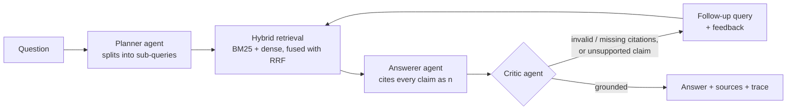

# Offline Agentic RAG

Multi-agent retrieval-augmented generation that runs **entirely on your own machine**: a local LLM (Ollama, llama.cpp or vLLM), a from-scratch hybrid search index, and a planner → answerer → critic loop that checks its own citations before it answers.

Built for the setting where cloud APIs are not an option: air-gapped networks, sensitive internal documents, or field laptops without connectivity.


## How it works



| Component | What it does | Why it is built this way |
|---|---|---|
| **Chunker** | Packs whole sentences into ≤ N chars with overlap | Facts that straddle a boundary stay retrievable; every chunk advances, so it cannot loop |
| **BM25** | Okapi BM25 over stemmed tokens, written from scratch | Exact-term matching (part numbers, figures, acronyms) that embeddings blur |
| **Dense index** | Exact cosine search over pluggable embeddings | Catches paraphrases BM25 misses |
| **RRF fusion** | `score = Σ 1 / (60 + rank)` across both lists | Rank-based, so no score normalisation between incomparable scales |
| **Planner** | Rewrites multi-part questions into ≤ 3 queries | Single-vector search fails on "X *and* Y" questions |
| **Critic** | Deterministic citation checks, then an LLM groundedness judge | Cheap checks catch hallucinated `[7]`s without spending a model call |
| **Loop** | Re-retrieves with the critic's follow-up query, bounded by `max_iterations` | Self-correction with a hard latency ceiling |

LLM output is never trusted to be well formed: JSON is parsed defensively and every agent has a deterministic fallback, so a small 3B model that ignores the format degrades gracefully instead of crashing.

## Quick start

```bash
pip install -e ".[api]"

# 1. Index a folder (.md, .txt; .pdf with the [pdf] extra)
agentrag ingest data/handbook --max-chars 400

# 2. Run a local model
ollama pull llama3.2:3b && ollama serve

# 3. Ask
agentrag ask "After a crash, who do I notify and what happens to the aircraft?"

# 4. Web UI + REST API at http://127.0.0.1:8000
agentrag serve
```

Any OpenAI-compatible local server works too: `agentrag ask "..." --backend openai --base-url http://localhost:8080/v1 --model qwen2.5-7b-instruct`.

### Embeddings

| Spec | Needs | Notes |
|---|---|---|
| `hashing` (default) | numpy only | Signed feature hashing of stemmed words + char trigrams. Zero downloads, deterministic; no synonym knowledge |
| `st:BAAI/bge-small-en-v1.5` | `pip install -e ".[neural]"` | Download once while online; loads from cache offline |
| `ollama:nomic-embed-text` | Ollama | Same server as the LLM |

## Evaluation

`eval/handbook_qa.jsonl` has 24 questions over the sample handbook in `data/handbook/` (an original, fictional drone-operations manual): 19 single-document, 3 multi-document, and 2 unanswerable questions that test abstention.

```bash
agentrag eval eval/handbook_qa.jsonl --k 1          # retrieval only, no model needed
agentrag eval eval/handbook_qa.jsonl --k 3 --e2e    # full pipeline with your local LLM
```

**Retrieval, hashing embedder, Hit@1 / MRR over 22 answerable questions** (fully reproducible, no model needed):

| Chunk size | BM25 | Dense (hashing) | **Hybrid (RRF)** |
|---|---|---|---|
| 800 chars (1 chunk per doc) | 0.955 / 0.955 | 0.909 / 0.909 | 0.909 / 0.909 |
| 200 chars (54 chunks) | 0.909 / 0.909 | 0.955 / 0.955 | **1.000 / 1.000** |

What this shows: with coarse chunks the task is easy and BM25 alone is enough. With fine-grained chunks, where each passage holds one or two facts, neither retriever is reliable on its own, and fusing them gets every question right at rank 1. The corpus is small, so treat this as a sanity check on the method, not a leaderboard number. A neural embedder is the obvious next experiment.

End-to-end metrics (`--e2e`) report keyword accuracy, groundedness rate, citation validity, abstention accuracy on unanswerable questions, mean critic iterations, and p50/p95 latency. Use `AgenticRAG(..., use_planner=False, use_critic=False)` to ablate each agent.

## API

| Method | Path | Body | Returns |
|---|---|---|---|
| `GET` | `/health` | — | chunk count, embedder |
| `POST` | `/query` | `{"question": "..."}` | answer, `grounded`, `abstained`, `iterations`, numbered sources, full agent trace |
| `POST` | `/documents` | `{"doc_id": "...", "text": "..."}` | adds a document to the live index |
| `GET` | `/` | — | single-page web UI |

## Project layout

```
src/agentrag/
  chunking.py    sentence-aware chunking with overlap
  text.py        tokeniser + light stemmer
  embeddings.py  hashing / sentence-transformers / Ollama embedders
  index.py       BM25, dense index, RRF fusion, persistence
  llm.py         Ollama, OpenAI-compatible, and scripted (test) backends
  agents.py      planner, answerer, critic + defensive JSON parsing
  pipeline.py    the self-correcting orchestration loop
  evaluate.py    retrieval and end-to-end metrics
  api.py         FastAPI service + web UI
  cli.py         ingest / ask / eval / serve
tests/           43 tests; the full pipeline is tested with a scripted LLM, no model needed
```

## Development

```bash
pip install -e ".[dev]"
pytest          # ~0.5 s
ruff check src tests
```

## Limitations and next steps

- Exact dense search is O(N); swap in FAISS/HNSW past ~10⁵ chunks.
- The keyword-match accuracy metric is a cheap proxy; an LLM-as-judge or exact-answer set would be stricter.
- Planner and critic each add a model call; on CPU-only machines run with `--max-iterations 1` or disable the planner.
- Cross-encoder re-ranking of the fused list is the next retrieval improvement to try.

## License

MIT
